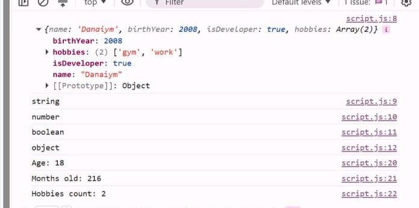
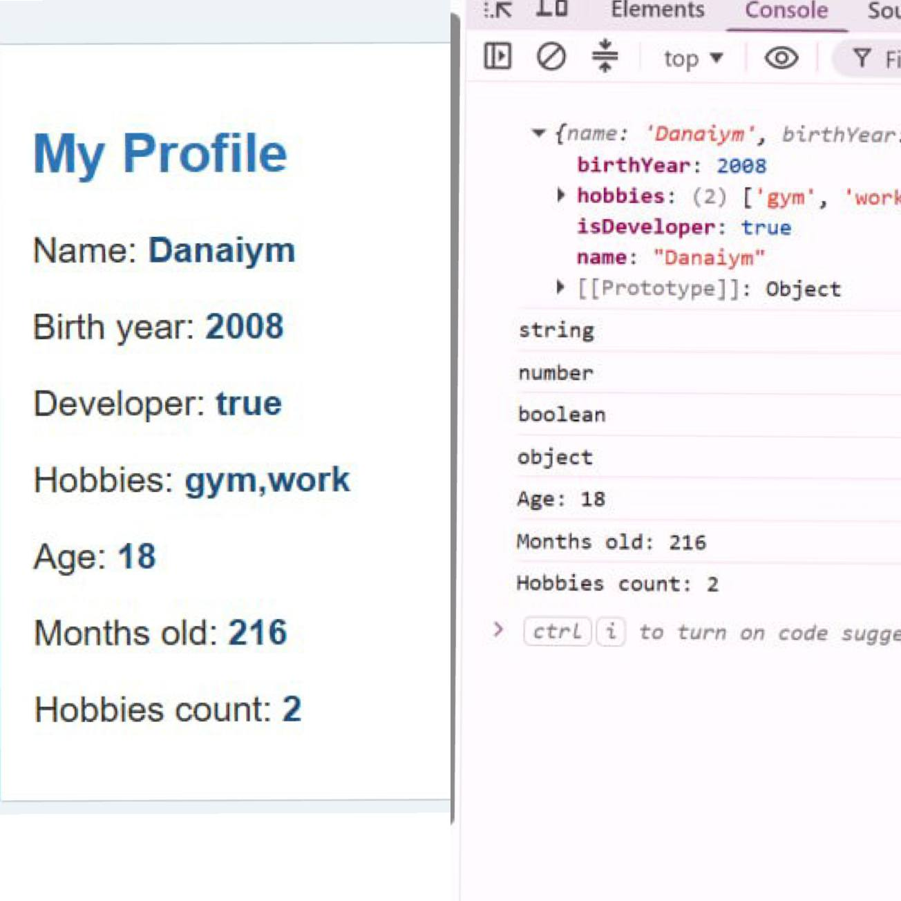
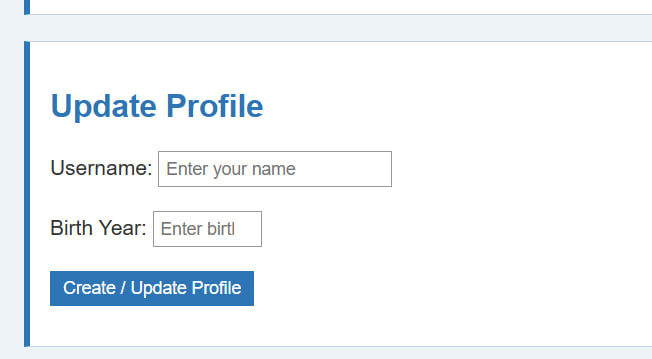
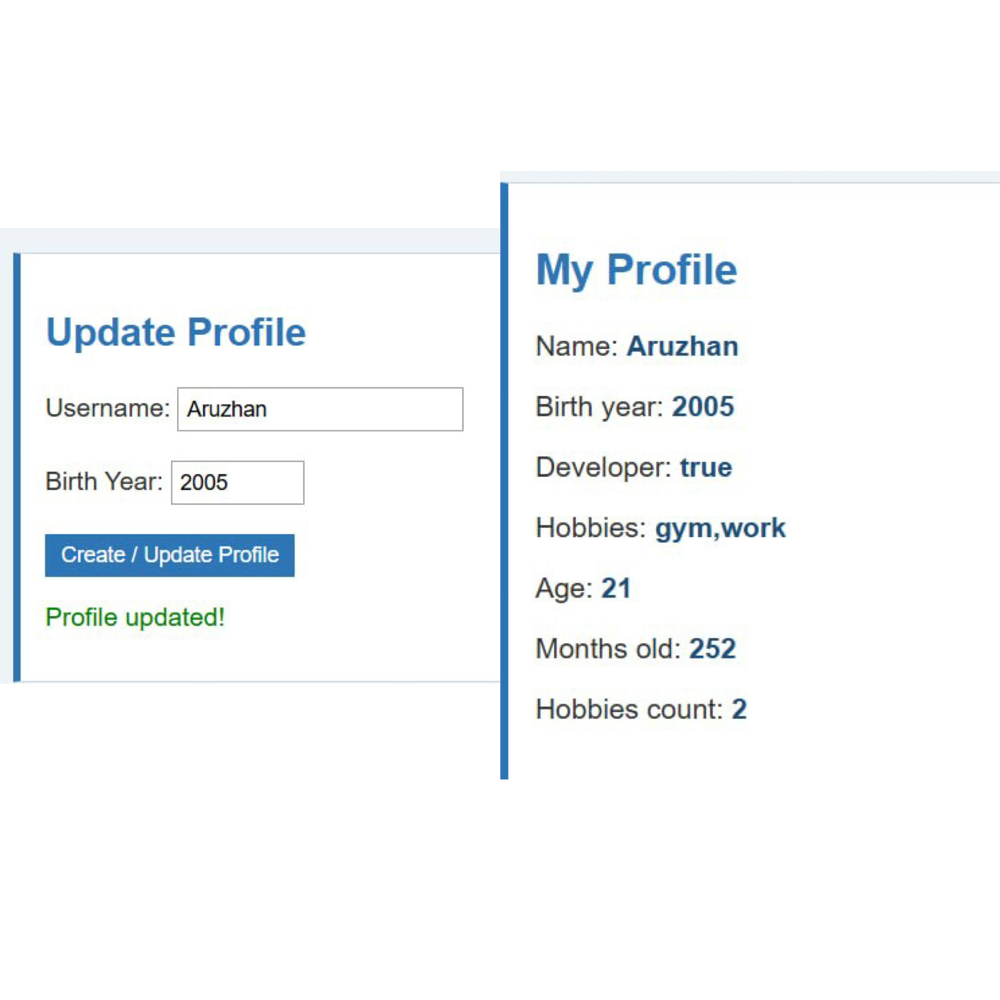
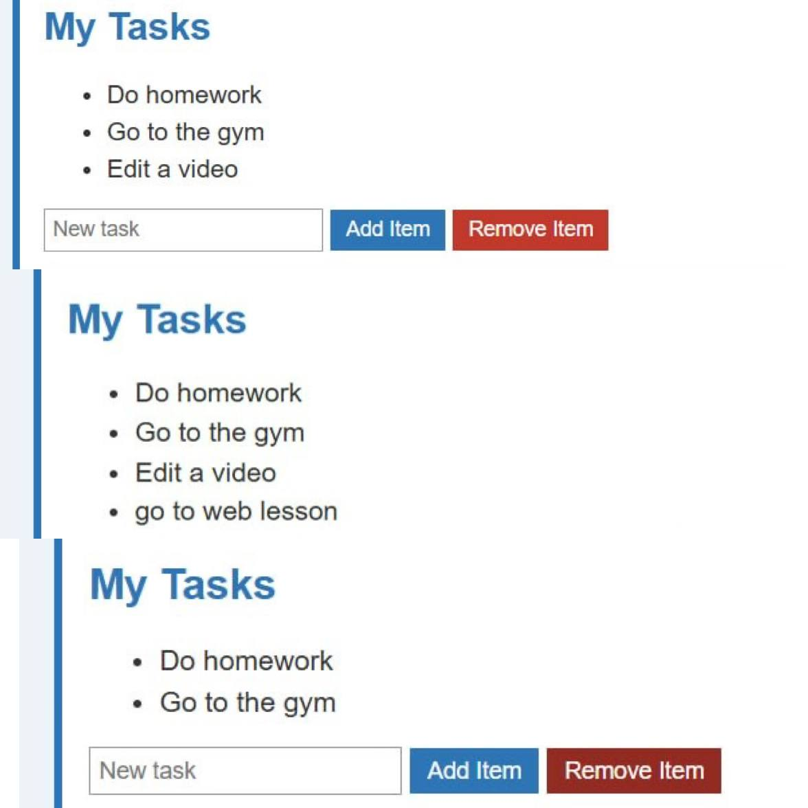

Assignment 5 - JavaScript Basics

Kapesova Danaiym, IT-2513

GitHub Pages link: https://danaiiim.github.io/web5/

Part 1. Profile Object, Data Types & Arithmetic

Task 1. The Personal Info Object

I made a const object userProfile. It has my name (string), birth year (number), isDeveloper (boolean) and my hobbies (array). I checked the types with typeof in the console.

Task 2. Arithmetic Calculations

I counted my age like current year minus birth year. Then I counted how many months old I am (age * 12) and how many hobbies I have. I showed it in the console and on the page.

Part 2. Form Input & Event Responses

Task 3. HTML Form Setup

I added two inputs, one for username and one for birth year, and a button Create / Update Profile.

Task 4. Event Listener

I added a click event to the button. When I click it, it takes the values from the inputs and changes the userProfile object, then the page shows the new info. If the fields are empty or the year is wrong it shows a red message.

Part 3. DOM List Manipulation

Task 5. Creating & Removing Elements

I made a list of my tasks. With the Add Item button I can write a new task and it adds a new li to the list. The Remove Item button deletes the last task.

Summary

In this assignment I started to work with JavaScript. I made an object with different data types and did some calculations. I learned how to get elements with getElementById, change text with textContent and change color with style. I used addEventListener for buttons and also learned how to add and remove elements from the list. At first I had a problem that the birth year could be any number, so I added a check for it.